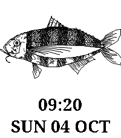

# ReelTime

A Pebble watchface that draws a new procedurally generated fish on your wrist.

Every interval — every minute, hour, or 12 hours — a fresh fish is generated on
your phone, streamed to the watch, and sketched on screen stroke by stroke.
The watchface shows the fish, the time, and the date.



## How it works

- The fish are drawn by **[fishdraw](https://github.com/LingDong-/fishdraw)** by
  Lingdong Huang — a single-file, dependency-free procedural generator that
  produces polylines for all sorts of weird fishes. It runs on the phone inside
  PebbleKit JS; only the resulting polylines are sent to the watch.
- Polylines are simplified and chunked (600 bytes per AppMessage) with a
  checksum, then animated on the watch as a ~3.5s quick-draw reveal.
- **Time mode** (optional): the fish is seeded from the wall-clock start of the
  current interval, so the same interval always shows the same fish — on any
  boot, reinstall, or phone. Turning it on also gives the fish a taller frame by
  reclaiming the name row.
- **Random mode** (default pairing with names): each interval gets its own fish
  with a generated Latin binomen displayed above the time (auto-fitted to the
  frame width).
- Settings are persisted on the watch, so everything survives reboots and
  phone disconnections.

## Settings

Open the config page from the Pebble app (watchface → settings):

| Setting | Options |
|---|---|
| New fish every… | 1 minute / 1 hour / 12 hours |
| Time-seeded mode | deterministic fish per interval, taller frame, no name |
| Border | thin frame around the fish, on/off |
| Colours | background, fish, text — 19-colour swatches or random |
| Line thickness | Thin (1px) / Normal (2px) / Bold (3px) |

## Building

Requires the [Pebble SDK](https://developer.rebble.io/). The app targets
**emery** (200×228, SDK 3).

```sh
pebble build
pebble install --emulator emery   # or --phone <device> for hardware
```

## Project layout

- `src/c/main.c` — watch app: receives polylines, caches them per bucket,
  draws the reveal animation, renders time/date/labels, persists settings.
- `src/pkjs/index.js` — phone side: runs fishdraw, chunks and sends the fish,
  renders the settings page, handles settings round-trips with the watch.
- `src/pkjs/fishdraw.js` — vendored copy of fishdraw (MIT, see
  `fishdraw.LICENSE`) with small patches for the PebbleKit JS bundler (exports
  `set_seed()` for reproducible generation, guards the CLI block, rewrites
  `**` to `Math.pow()` for the SDK's ES2015 parser).
- `resources/images/menu_icon.png` — launcher icon, generated by
  `tools/gen_icon.py`.
- `tools/` — helpers for previewing the fonts and generating the icon.

## Credits

- Fish drawings by **[fishdraw](https://github.com/LingDong-/fishdraw)**
  © 2021 Lingdong Huang, MIT License. A reference copy lives in
  `vendor/fishdraw/`.
- Built for Pebble / Rebble.
